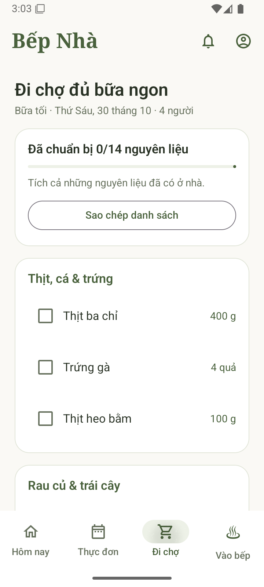

# Bếp Nhà — Android native (Kotlin + Jetpack Compose)

Bản 0.2.0-native là ứng dụng Android native. Các màn hình, điều hướng, ô nhập, hộp thoại và danh sách được dựng bằng Jetpack Compose; không dùng WebView, HTML hoặc JavaScript để hiển thị ứng dụng.

## Cài bản thử

Chép `releases/BepNha-0.2.0-native-debug.apk` sang điện thoại Android 8.0 trở lên rồi mở tệp để cài. Đây là APK debug, chưa phát hành lên Google Play. Khi Android hỏi, cấp quyền thông báo để nhận nhắc nấu; trong **Nhắc nấu** có nút mở quyền **Nhắc đúng giờ**.

APK không cần đăng nhập ChatGPT và không phụ thuộc Android System WebView. 14 công thức cùng ảnh minh họa có sẵn trong gói, dùng được offline. Dữ liệu của bản WebView 0.1 và bản web chưa được nhập tự động sang kho dữ liệu native mới.

## Những màn hình đã có

- **Hôm nay:** chọn ngày/bữa, xem ba món, chi phí và thời gian ước tính; đổi riêng từng món, lưu món yêu thích.
- **Thực đơn:** kế hoạch bảy ngày, mỗi bữa có món mặn, canh và rau. Lựa chọn đã lưu được giữ khi sang ngày mới.
- **Công thức:** nguyên liệu theo số người, các bước bằng chữ và mẹo nấu; mở bằng bottom sheet native.
- **Đi chợ:** gộp nguyên liệu cùng tên và đơn vị, tích đồ đã có và sao chép danh sách qua clipboard Android.
- **Vào bếp:** timeline tính ngược từ giờ ăn, canh/rau dùng lần lượt một vùng bếp; tích công việc, mở công thức và đặt đồng hồ. Đồng hồ giữ đúng bữa gốc khi bạn xem ngày khác.
- **Gia đình:** tên, số người từ 1–12 và giờ ăn bằng đồng hồ chọn giờ Android; đổi khẩu phần cập nhật định lượng.
- **Hỏi Bếp Nhà:** ô nhập native để tra món, xem lịch nấu, tìm món nhanh hoặc tiết kiệm trong công thức có sẵn. Chưa có AI tạo sinh.
- **Nhắc nấu:** lưu lịch bằng AlarmManager, gửi thông báo Android, chạm thông báo mở đúng bữa ăn; cập nhật/hủy lịch khi thay đổi thực đơn, giờ ăn hoặc đồng hồ.

Thêm sự kiện vào lịch bằng màn hình soạn sự kiện của ứng dụng lịch. Người dùng xác nhận lưu; Bếp Nhà không yêu cầu quyền đọc hoặc ghi lịch. Ứng dụng không khai báo quyền Internet.

## Giao diện chạy trên máy ảo



## Cấu trúc native

| Tệp | Vai trò |
| --- | --- |
| `MainActivity.kt` | Điểm vào Compose, quyền, lịch hệ thống, clipboard và đồng hồ chọn giờ |
| `PlannerApp.kt`, `PlannerSheets.kt`, `PlannerTheme.kt` | Giao diện và điều hướng Android native |
| `PlannerViewModel.kt` | Trạng thái UI, thao tác người dùng, đồng hồ và xử lý thông báo |
| `PlannerEngine.kt`, `PlannerModels.kt` | Thực đơn, đổi món, định lượng, timeline và lịch nhắc thuần Kotlin |
| `PlannerStorage.kt` | Đọc công thức và lưu trạng thái bằng SharedPreferences trên luồng IO tuần tự |
| `ReminderStore.java`, `ReminderReceiver.java` | Đặt/hủy/khôi phục lịch và hiện thông báo Android |
| `src/main/assets/recipes.json` | Dữ liệu 14 công thức được đóng gói trong APK |
| `src/main/res/drawable-nodpi/family_meal.webp` | Ảnh minh họa được đóng gói như tài nguyên Android |

Các tệp Kotlin/Java ở `app/src/main/java/vn/team03/bepnha/`. Build Android không dùng hoặc sao chép mã trong `ui/`.

## Mở và build

Mở thư mục `android/` trong Android Studio. Dùng JDK 17, SDK Platform 36 và Build Tools 35.0.0. Phiên bản đã ghim: AGP 8.13.2, Gradle 8.13, Kotlin/Compose Compiler 2.2.10 và Compose BOM 2025.08.00.

```bash
./gradlew testDebugUnitTest assembleDebug lintDebug
```

Windows dùng `gradlew.bat`. APK nằm ở `app/build/outputs/apk/debug/app-debug.apk`. Không cần Node, npm, máy chủ web hay khóa API để build/chạy bản Android.

Kiểm thử giao diện cần máy ảo riêng vì bộ kiểm thử xóa dữ liệu thử nghiệm Bếp Nhà trước mỗi ca:

```bash
./gradlew connectedDebugAndroidTest
```

## Xác minh

Đã build bản native, chạy **12 unit test** và **6 kiểm thử instrumentation trên máy ảo Android 15/API 35**. Kiểm thử gồm: xác nhận có AndroidComposeView và không có WebView trong cây màn hình; đổi món; công thức chữ; danh sách đi chợ; khẩu phần sáu người; lưu/đọc dữ liệu; và hủy PendingIntent khi tắt nhắc. Unit test kiểm tra timeline hai vùng bếp, định lượng, giữ thực đơn qua ngày mới, nhắc quá hạn và đồng hồ giữ bữa gốc.

Ảnh chụp native được tạo trực tiếp bằng Android instrumentation, không phải ảnh mockup. Android Lint không có lỗi chặn. Chưa kiểm tra trên điện thoại thật, các chế độ ngủ/tiết kiệm pin, reboot thực tế hoặc giao thông báo đúng giờ trên từng hãng máy.

## Giới hạn

Giờ nấu và giá là ước tính, cần kiểm tra độ chín thực tế. Dữ liệu lưu trên thiết bị, chưa có tài khoản hoặc đồng bộ. Chỉ có một đồng hồ đếm ngược tại một thời điểm; nhắc từng bữa hoạt động độc lập.

Thông báo cần quyền của người dùng; quyền Alarms & reminders hỗ trợ nhắc đúng giờ trên Android tương ứng. Tiết kiệm pin hoặc hạn chế ứng dụng của nhà sản xuất vẫn có thể ảnh hưởng. Dừng bắt buộc ứng dụng ngăn nhắc cho đến khi mở lại.

## AI use và tài liệu

Codex viết phần Kotlin/Compose native, logic thực đơn, persistence, unit test, instrumentation test và tài liệu; Codex thực hiện build và chạy các kiểm tra nêu trên. Phần nhắc Android bằng Java được giữ lại từ bản thử trước. Ảnh mâm cơm được tái sử dụng từ ảnh imagegen của dự án, có prompt và công bố trong `../ui/bep-nha/README.md`. Chưa có bằng chứng review thủ công của thành viên nhóm.

Tham khảo: [Jetpack Compose](https://developer.android.com/develop/ui/compose), [Compose Compiler Gradle plugin](https://developer.android.com/develop/ui/compose/setup-compose-dependencies-and-compiler), [quyền thông báo](https://developer.android.com/develop/ui/views/notifications/notification-permission), [AlarmManager](https://developer.android.com/develop/background-work/services/alarms).
