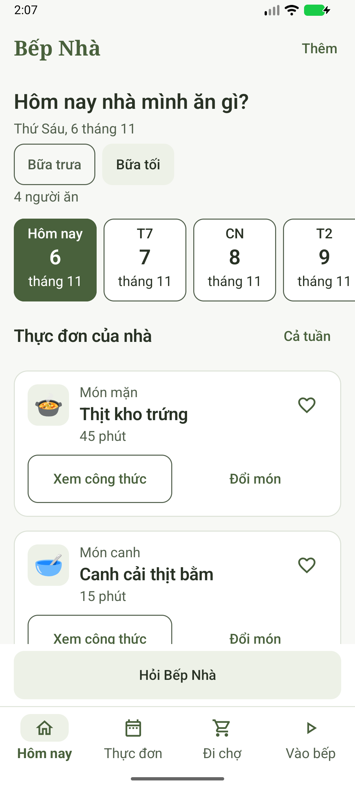

# Bếp Nhà — Android native (Kotlin + Jetpack Compose)

Bản 0.3.0-native là ứng dụng Android native. Các màn hình, điều hướng, ô nhập, hộp thoại và danh sách được dựng bằng Jetpack Compose; không dùng WebView, HTML hoặc JavaScript để hiển thị ứng dụng.

## Cài bản thử

Build bản UI điện thoại mới rồi chép `app/build/outputs/apk/debug/app-debug.apk` sang điện thoại Android 8.0 trở lên để cài. APK trong `releases/` là bản cũ, không chứa các thay đổi UI mới. Đây là APK debug, chưa phát hành lên Google Play. Khi Android hỏi, cấp quyền thông báo để nhận nhắc nấu; trong **Nhắc nấu** có nút mở quyền **Nhắc đúng giờ**.

APK không cần đăng nhập ChatGPT và không phụ thuộc Android System WebView. 66 công thức có sẵn trong gói, dùng được offline. Cả 66 món trong bản demo đều có ảnh minh họa được đóng gói trong APK. Xem [kịch bản demo offline](docs/demo-offline.md). Dữ liệu của bản WebView 0.1 và bản web chưa được nhập tự động sang kho dữ liệu native mới.

## Những màn hình đã có

- **Hôm nay:** chọn ngày/bữa, xem thực đơn tuần, chi phí và thời gian ước tính; đổi riêng từng món, lưu món yêu thích.
- **Thực đơn:** kế hoạch bảy ngày, bữa sáng có một món, bữa trưa và tối có món mặn, canh và rau. Lựa chọn đã lưu được giữ khi sang ngày mới.
- **Công thức:** nguyên liệu theo số người, các bước bằng chữ và mẹo nấu; mở bằng bottom sheet native.
- **Đi chợ:** chọn một bữa, nhiều bữa hoặc cả ngày, gộp nguyên liệu và đánh dấu những thứ đã có. Có thể sao chép hoặc chia sẻ danh sách.
- **Vào bếp:** timeline tính ngược từ giờ ăn, canh/rau dùng lần lượt một vùng bếp; tích công việc, mở công thức, dùng **Nấu cùng tôi** để nghe từng bước, và đặt tối đa bốn đồng hồ. Đồng hồ giữ đúng bữa gốc khi bạn xem ngày khác.
- **Gia đình:** tên, số người từ 1–12 và giờ ăn bằng đồng hồ chọn giờ Android; đổi khẩu phần cập nhật định lượng.
- **Hỏi bếp:** tab **Tủ lạnh** gợi ý món từ nguyên liệu nhập bằng tay hoặc giọng nói. **Trò chuyện** mở cùng trợ lý với nút **Hỏi Bếp Nhà**. Trợ lý tra công thức, gợi ý mâm theo nguyên liệu, chọn mâm, chỉnh riêng món và xác nhận thay đổi. Gemini chạy qua Firebase AI Logic/Spark; mất mạng hoặc hết quota chuyển sang xử lý Kotlin trên máy. Xem [hướng dẫn Firebase](../docs/firebase-spark-demo.md).
- **Nhắc nấu:** lưu lịch bằng AlarmManager, gửi thông báo Android, chạm thông báo mở đúng bữa ăn; cập nhật/hủy lịch khi thay đổi thực đơn, giờ ăn hoặc đồng hồ. Nhắc đi chợ được cài trong **Gia đình**.

Thêm sự kiện vào lịch bằng màn hình soạn sự kiện của ứng dụng lịch. Người dùng xác nhận lưu; Bếp Nhà không yêu cầu quyền đọc hoặc ghi lịch. Ứng dụng dùng quyền Internet để gọi trợ lý; thực đơn và tra cứu offline vẫn dùng được khi mất mạng.

## Giao diện chạy trên máy ảo



Ảnh mới từ máy ảo và các trường hợp chữ lớn nằm trong [docs/phone-ui](docs/phone-ui). Xem [thiết kế điện thoại, kiểm thử và bàn giao backend](docs/phone-ui-handoff.md).

## Cấu trúc native

| Tệp | Vai trò |
| --- | --- |
| `MainActivity.kt` | Điểm vào Compose, quyền, lịch hệ thống, clipboard và đồng hồ chọn giờ |
| `PlannerApp.kt`, `PlannerSheets.kt`, `PlannerTheme.kt` | Giao diện và điều hướng Android native |
| `PlannerViewModel.kt` | Trạng thái UI, thao tác người dùng, đồng hồ và xử lý thông báo |
| `PlannerEngine.kt`, `PlannerModels.kt` | Thực đơn, đổi món, định lượng, timeline và lịch nhắc thuần Kotlin |
| `PlannerStorage.kt` | Đọc công thức và lưu trạng thái bằng SharedPreferences trên luồng IO tuần tự |
| `ReminderStore.java`, `ReminderReceiver.java` | Đặt/hủy/khôi phục lịch và hiện thông báo Android |
| `src/main/assets/recipes.json` | Dữ liệu 66 công thức được đóng gói trong APK |
| `src/main/res/drawable-nodpi/family_meal.webp` | Ảnh minh họa được đóng gói như tài nguyên Android |

Các tệp Kotlin/Java ở `app/src/main/java/vn/team03/bepnha/`. Build Android không dùng hoặc sao chép mã trong `ui/`.

## Mở và build

Mở thư mục `android/` trong Android Studio. Dùng JDK 17, SDK Platform 36 và Build Tools 35.0.0. Phiên bản đã ghim: AGP 8.13.2, Gradle 8.13, Kotlin/Compose Compiler 2.2.10 và Compose BOM 2025.08.00.

```bash
./gradlew testDebugUnitTest assembleDebug lintDebug
```

Windows dùng `gradlew.bat`. APK nằm ở `app/build/outputs/apk/debug/app-debug.apk`. Không cần Node, npm, máy chủ web hay khóa API để build/chạy bản Android.

Trên Windows, chạy kiểm thử local với JDK 17 hoặc 21 đã đặt trong `JAVA_HOME`:

```powershell
.\scripts\check-local.ps1
```

Script chạy unit test, build APK rồi build APK kiểm thử giao diện và chạy lint. Nó giới hạn Gradle ở một worker, kiểm tra RAM còn trống trước mỗi lượt và dừng nếu emulator đang chạy. Sau khi sửa lỗi, dùng `-Phase Unit`, `-Phase Build` hoặc `-Phase Verify` để chạy lại lượt tương ứng. Thêm `-Offline` khi các dependency đã có trong cache.

Kiểm thử giao diện cần máy ảo riêng vì bộ kiểm thử xóa dữ liệu thử nghiệm Bếp Nhà trước mỗi ca:

```bash
./gradlew connectedDebugAndroidTest
```

## Xác minh

Đợt Firebase Spark: **46 JVM tests và 30 instrumentation tests đạt**, năm ca Firebase thật tách riêng và không chạy trong suite thường. Lint: 0 lỗi, 6 cảnh báo. Xem [kết quả nghiệm thu mới](../docs/firebase-spark-verification.md). Phần thống kê dưới đây là lịch sử đợt UI trước.

Đợt cập nhật UI điện thoại: **18 unit test** và **26 kiểm thử instrumentation trên máy ảo Android API 37** đạt. Bao gồm các luồng native cũ, tương phản chữ, chữ 200%, vùng nhập khi thiếu chiều cao, giữ bản nháp qua xoay máy, gửi lại không trùng, loại phản hồi cũ, xác nhận một lần và giữ vị trí khi đang đọc hội thoại. Xem phạm vi và giới hạn trong [bàn giao UI điện thoại](docs/phone-ui-handoff.md).

Ảnh chụp native được tạo trực tiếp bằng Android instrumentation, không phải ảnh mockup. Android Lint không có lỗi chặn. Chưa kiểm tra trên điện thoại thật, các chế độ ngủ/tiết kiệm pin, reboot thực tế hoặc giao thông báo đúng giờ trên từng hãng máy.

## Giới hạn

Giờ nấu và giá là ước tính, cần kiểm tra độ chín thực tế. Dữ liệu lưu trên thiết bị, chưa có tài khoản hoặc đồng bộ. Có tối đa bốn đồng hồ đếm ngược. Nhắc từng bữa hoạt động độc lập.

Thông báo cần quyền của người dùng; quyền Alarms & reminders hỗ trợ nhắc đúng giờ trên Android tương ứng. Tiết kiệm pin hoặc hạn chế ứng dụng của nhà sản xuất vẫn có thể ảnh hưởng. Dừng bắt buộc ứng dụng ngăn nhắc cho đến khi mở lại.

## AI use và tài liệu

Codex viết phần Kotlin/Compose native, logic thực đơn, persistence, unit test, instrumentation test và tài liệu; Codex thực hiện build và chạy các kiểm tra nêu trên. Phần nhắc Android bằng Java được giữ lại từ bản thử trước. Ảnh mâm cơm được tái sử dụng từ ảnh imagegen của dự án, có prompt và công bố trong [nguồn ảnh minh họa](docs/image-provenance.md). Chưa có bằng chứng review thủ công của thành viên nhóm.

Tham khảo: [Jetpack Compose](https://developer.android.com/develop/ui/compose), [Compose Compiler Gradle plugin](https://developer.android.com/develop/ui/compose/setup-compose-dependencies-and-compiler), [quyền thông báo](https://developer.android.com/develop/ui/views/notifications/notification-permission), [AlarmManager](https://developer.android.com/develop/background-work/services/alarms).

## Trợ lý Gemini

Xem [cấu hình Firebase Spark, App Check và kiểm thử](../docs/firebase-spark-demo.md). Nút **Hỏi Bếp Nhà** nằm ngay trên thanh điều hướng. Menu **Thêm** mở Gia đình, Nhắc nấu và Món đã lưu. Màn chat giữ ngữ cảnh bữa/ngày/số người phía trên, hội thoại ở giữa và ô nhập ở dưới. Gợi ý điền vào ô nhập để người dùng chỉnh trước khi gửi. Đổi thực đơn, hồ sơ ăn uống, khẩu phần và giờ ăn cần xác nhận. Các thao tác rủi ro thấp có thể áp dụng ngay và có Hoàn tác.

### Kết nối Firebase vào chat

- Tải `app/google-services.json` bằng Firebase CLI theo hướng dẫn. File được bỏ qua trong Git. Không nhúng Gemini key vào APK.
- `AssistantService` nhận câu hỏi, tối đa 20 tin lịch sử và snapshot; `FirebaseAssistantProvider` gọi SDK Firebase. `MealPlanning` kiểm tra ngày/bữa, nguyên liệu và tự xếp mâm; `AssistantCommands` kiểm tra và thực thi sau xác nhận.
- Mỗi lượt tối đa bốn lần gọi AI, tối đa sáu tool call trong một phản hồi, 48 thao tác trong một đề xuất và hai phương án mâm.
- Khi thiếu cấu hình, dùng trợ lý cục bộ với nhãn nguồn và lý do. Màn nhập key và backend URL không còn dùng.
- Chỉ debug build bật App Check Debug Provider. Mỗi thiết bị demo cần đăng ký; release build dùng cục bộ cho đến khi có phương án chứng thực phát hành.
- Hội thoại giữ trong phiên qua xoay màn hình và xem công thức. Bản nháp Chat dùng SavedStateHandle; lưu 30 tin nhắn gần nhất trên máy và cho phép xóa lịch sử. Đề xuất chưa thực hiện không được phục hồi sau khi thoát tiến trình.
