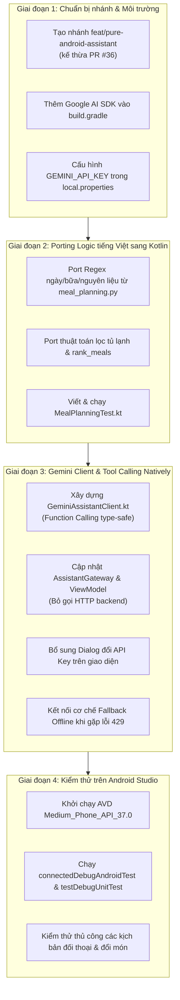

# Kế hoạch thực hiện hoàn chỉnh: Ứng dụng Lên Thực Đơn Bếp Nhà
## Kiến trúc Pure Android & Gemini Tool Calling

> [!NOTE]
> **Bối cảnh & Quyết định thiết kế đã thống nhất qua phỏng vấn:**
> 1. **Kiến trúc:** Pure Android (Client-Only). Không dùng Python backend host để APK chạy độc lập 100% trên mọi thiết bị.
> 2. **Tích hợp AI:** Sử dụng thư viện chính thức Google AI Client SDK (`com.google.ai.client.generativeai`).
> 3. **Quản lý API Key:** Nhúng mặc định qua `local.properties` / `BuildConfig`, kèm ô nhập/đổi API Key trong giao diện app.
> 4. **Khả năng chịu lỗi:** Hybrid (ưu tiên Gemini Online, tự động fallback sang bộ quy tắc nội bộ khi mất mạng hoặc hết quota 429).
> 5. **Kiểm thử:** Kết hợp tự động (Unit Test JVM + Instrumented UI Test) và kiểm thử thủ công trực tiếp trên Android Studio với máy ảo `Medium_Phone_API_37.0`.

---

## 1. Bản đồ công việc (Work Breakdown Structure)



---

## 2. Chi tiết từng giai đoạn thực hiện

### Giai đoạn 1: Chuẩn bị nhánh & Môi trường
* **Nguồn kế thừa:** Nhánh `origin/backend-testing` (PR #36). Nhánh này đã có sẵn các cải tiến giao diện Compose quan trọng (card mâm cơm `assistant-meal-1`, nút "Sửa đề xuất", nút "Áp dụng").
* **Thao tác Git:**
  ```bash
  git checkout -b feat/pure-android-assistant origin/backend-testing
  ```
* **Thêm SDK vào `android/app/build.gradle`:**
  ```groovy
  dependencies {
      // Google AI Client SDK cho Android
      implementation 'com.google.ai.client.generativeai:generativeai:0.9.0'
  }
  ```
* **Cấu hình API Key an toàn:**
  * Đọc `geminiApiKey` từ `local.properties` (file này nằm trong `.gitignore`, không lo lộ lên Git).
  * Truyền vào `BuildConfig.GEMINI_API_KEY`.

---

### Giai đoạn 2: Porting Logic Tiếng Việt & Xếp Hạng Món sang Kotlin
* **Tệp mới:** `android/app/src/main/java/vn/team03/bepnha/MealPlanning.kt`
* **Nội dung chuyển ngữ:**
  1. `normalizeText(text)`: Chuẩn hóa tiếng Việt bỏ dấu (sử dụng `java.text.Normalizer`).
  2. `parseDay()`, `mentionedDays()`: Nhận diện "hôm nay", "ngày mai", "ngày mốt", "thứ ba..chủ nhật", "d/M", "ISO".
  3. `mentionedMeals()`: Nhận diện "trưa", "tối", từ chối yêu cầu bữa sáng thân thiện.
  4. `pantryNames()`: Bóc tách danh sách đồ ăn còn/hết trong tủ lạnh kèm từ phủ định ("hết thịt", "không còn trứng").
  5. `rankMeals()`: Thuật toán tổ hợp 3 món (mặn, canh, rau) từ catalog dựa theo số nguyên liệu có sẵn.
* **Kiểm thử JVM tương ứng:**
  * `android/app/src/test/java/vn/team03/bepnha/MealPlanningTest.kt` kiểm tra toàn bộ các ca phân tích câu hỏi tiếng Việt.

---

### Giai đoạn 3: Xây dựng Native Gemini Tool Calling & Hybrid Fallback
* **Tệp cải tiến:** `android/app/src/main/java/vn/team03/bepnha/AssistantGateway.kt`
* **Định nghĩa Tools (Function Declarations):**
  * `swap_recipe(date, meal, index, recipe_id)`
  * `set_people(people)`
  * `suggest_meals(date, meal, recipe_ids, pantry_keys)`
* **System Prompt chuẩn tiếng Việt:**
  * Giới hạn catalog 14 món trong `recipes.json`.
  * Hướng dẫn Gemini gọi tool `swap_recipe` hoặc `suggest_meals` khi người dùng yêu cầu đổi món hoặc gợi ý mâm cơm theo tủ lạnh.
* **Cơ chế Fallback & Kháng lỗi:**
  * Nếu phát hiện lỗi HTTP 429 hoặc mất mạng: Chuyển sang gọi hàm `MealPlanning.rankMeals()` cục bộ để tạo danh sách gợi ý mâm cơm ngay lập tức kèm thông báo: *"Đang dùng gợi ý cục bộ do AI hết hạn mức / mất mạng."*
* **UI Quản lý API Key:**
  * Thêm icon/menu nhỏ ở góc màn hình Assistant cho phép xem trạng thái key và đổi key mới nếu cần.

---

### Giai đoạn 4: Kiểm thử trên Android Studio & Máy ảo

#### 4.1. Kiểm thử tự động (Automated Testing)
1. **Chạy Unit Test trên JVM:**
   ```powershell
   cd android
   .\gradlew.bat testDebugUnitTest
   ```
   *Yêu cầu:* Toàn bộ unit test cũ và `MealPlanningTest.kt` mới đều Passed.
2. **Khởi động AVD và chạy Instrumented UI Test:**
   ```powershell
   & "C:\Users\Windows\AppData\Local\Android\Sdk\emulator\emulator.exe" -avd Medium_Phone_API_37.0 -netdelay none -netspeed full
   .\gradlew.bat connectedDebugAndroidTest
   ```
   *Yêu cầu:* Bộ test `AssistantFlowTest.kt` thực thi tự động các thao tác: bấm mở chat, nhập câu hỏi, click chọn mâm 1, click "Sửa đề xuất", xác nhận và kiểm tra dữ liệu thực đơn cập nhật thành công.

#### 4.2. Kiểm thử thủ công (Manual Verification Scenarios)

| STT | Kịch bản kiểm thử | Hành vi mong đợi của App |
|:---:|---|---|
| **1** | Gợi ý theo tủ lạnh: *"Tủ lạnh có thịt heo, rau muống, tối mai nấu gì?"* | Hiển thị các thẻ mâm cơm gợi ý chứa thịt heo và rau muống, đánh dấu nguyên liệu có sẵn. |
| **2** | Tinh chỉnh mâm: Chat *"Lấy mâm 1"* rồi chat *"À đổi món canh"* | Chọn mâm 1, sau đó chỉ thay thế duy nhất món canh, giữ nguyên món mặn và rau. |
| **3** | Đổi món mặn trực tiếp: *"Trưa nay đổi thịt kho thành đậu hũ"* | Hiện khung xem trước đề xuất: *"Đổi Thịt kho -> Đậu hũ sốt cà"*. Bấm Áp dụng -> màn hình thực đơn cập nhật ngay. |
| **4** | Lỗi hạn mức / Mất mạng (Chế độ máy bay) | Không bị văng app; tự động hiển thị gợi ý cục bộ hoặc thông báo cho phép đổi API Key. |
| **5** | Đổi API Key trong app | Nhập key mới vào dialog -> Các câu chat tiếp theo sử dụng key mới thành công. |

---

## 3. Tiêu chuẩn nghiệm thu (Definition of Done)
1. Không còn phụ thuộc vào bất kỳ tiến trình Python nào khi chạy ứng dụng.
2. Cài đặt file `app-debug.apk` lên bất kỳ điện thoại Android nào cũng chạy được đầy đủ tính năng.
3. Toàn bộ Unit Test và Instrumented Test đều chạy thành công trên máy ảo `Medium_Phone_API_37.0`.
4. Người dùng có thể chat đổi món linh hoạt và áp dụng thay đổi vào thực đơn 7 ngày trơn tru.
